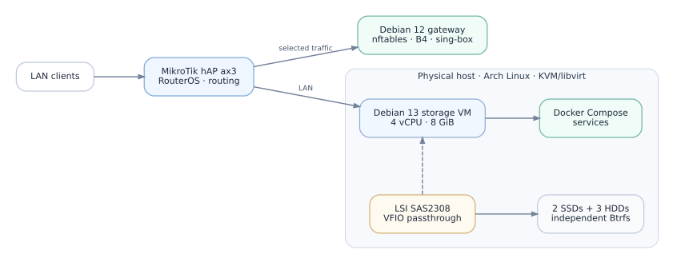

# Homelab infrastructure

A Linux infrastructure I built and maintain on my own hardware. It combines a KVM virtual machine, self-hosted applications, a separate Linux network gateway and Btrfs storage. This repository describes how the pieces fit together, why I made some of the design choices and how I operate them.

## What runs here

| Layer | Implementation |
| --- | --- |
| **Router** | MikroTik hAP ax3 (RouterOS): LAN, policy routing, normal ISP uplink and a public-IPv4 L2TP connection |
| **Linux gateway** | Debian 12 on a separate physical machine: B4, nftables, NFQUEUE/TPROXY, sing-box and WireGuard |
| **Hypervisor** | Arch Linux, Ryzen 7 5700G, 64 GB DDR4-3200, KVM/libvirt and a bridged Debian 13 VM |
| **Application platform** | Docker Compose on the `storage` VM; Caddy serves internal hostnames and routes requests to applications |
| **Storage** | VFIO passthrough of an LSI SAS2308 HBA; two SSDs and three HDDs in the VM, plus a fourth 4 TB HDD on the hypervisor |

## Networking

The router forwards selected LAN traffic to the Debian gateway over a dedicated transit link. The gateway handles packet classification and transparent interception with nftables, B4 and sing-box. RouterOS keeps separate routing policies for management traffic, normal ISP egress and the public-IPv4 L2TP path. WireGuard provides remote access.

Internal services use `home.arpa` names. MikroTik holds the local DNS records; Caddy on `storage` routes HTTP requests such as `git.home.arpa` and `photos.home.arpa` to applications on local ports. A Netwatch DNS probe checks the Proxybox resolver and switches **both the upstream DNS servers and the `via-proxybox` route** when the probe changes state. The router remains the DNS endpoint advertised to LAN clients.

**Key technologies:** Linux policy routing (`ip rule`), nftables, NFQUEUE, TPROXY, NAT, DNS, Caddy, WireGuard and RouterOS routing tables.

[Network, DNS and failover](docs/network-architecture.md) · [Transparent packet processing](docs/transparent-proxy-architecture.md)

## Virtualization and applications

The Arch Linux host runs a Debian `storage` VM with **4 vCPUs and 8 GiB RAM**. Its OS and service filesystems use separate QCOW2 virtual disks. A passed-through **LSI SAS2308** controller gives the VM direct access to five physical disks; the controller is reserved on the host with `vfio-pci`.

On the VM, Docker Compose manages Forgejo, Immich with PostgreSQL and Valkey, Navidrome, Copyparty, ArchiveBox and other services. Application state, bulk media and Compose configuration are stored separately from the containers' writable layers. Caddy provides hostname-based access without requiring each service to expose its own LAN port.

[Virtualization and VFIO](docs/virtualization.md) · [Container platform](docs/container-platform.md) · [Hardware inventory](docs/inventory.md)

## Storage and recovery

The five passed-through disks use **independent single-device Btrfs filesystems**, rather than RAID. SSD-B stores application data; SSD-A is used for Forgejo replication. HDD-A holds the main file collection, and HDD-B holds a full Btrfs copy of its `files` subvolume. HDD-C provides additional storage. A fourth 4 TB Btrfs disk on the hypervisor contains personal archives.

For Forgejo I implemented a backup workflow that briefly stops the application for a consistent SQLite snapshot, restarts it, and replicates the read-only Btrfs snapshot to the second SSD. **Incremental `btrfs send/receive` runs through a systemd service and daily timer.** I also restored a copy into an isolated Docker container and checked that the application responded over HTTP and its SQLite database passed an integrity check. The unattended timer has run successfully.

The bulk file archive was copied separately from HDD-A to HDD-B with Btrfs send/receive. The destination is a read-only received snapshot; selected restored files were compared byte-for-byte with the source. This archive copy is an on-demand operation, not the scheduled Forgejo workflow.

[Storage layout](docs/storage-architecture.md) · [Forgejo backup and restore](docs/services/forgejo-backup-and-restore.md) · [Backup script and systemd units](examples/backup/forgejo/README.md)

## Operating the infrastructure

Beyond deployment, the project includes service startup ordering and recovery work. On Proxybox, systemd units ensure that secondary IPv4 identities and the default route are present before WireGuard, sing-box and B4 start. The repository includes sanitized examples of that readiness gate and of the Forgejo backup timer.

[Proxybox systemd example](examples/systemd/proxybox/README.md) · [Forgejo backup example](examples/backup/forgejo/README.md)

