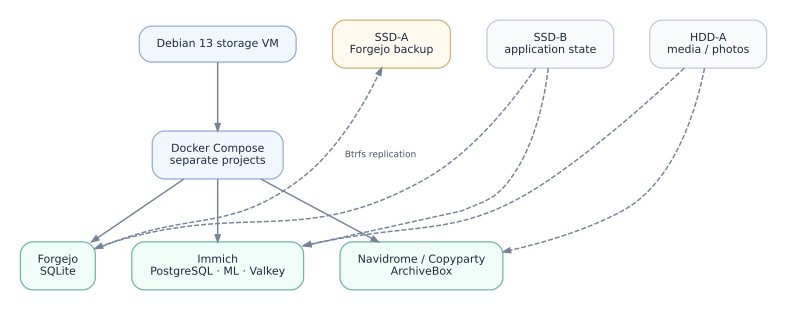

# Docker Compose application platform

Applications run in Docker Compose projects inside the Debian `storage` VM. Compose files live below `/srv/services/<project>/`; persistent data is stored on host-mounted filesystems and bind-mounted into containers as needed.

## Application layout

| Workload | Components | Persistent data |
| --- | --- | --- |
| Forgejo | Rootless Forgejo container, SQLite | Repository data, SQLite and configuration on SSD-B |
| Immich | Server, PostgreSQL, Valkey and machine-learning service | Application/database state on SSD-B; media on HDD-A |
| Navidrome | Music server | Application state on SSD-B; media mounted from HDD-A |
| Copyparty | Web file service | Data directories on HDD-A |
| ArchiveBox | Web archiving service | Bind-mounted archive data and Docker volumes |
| qBittorrent / slskd / deemix | Personal media tools | Compose-managed services with their own data mounts |

Compose provides service definitions, restart policies and per-project Docker networks. Database state, uploaded files and service configuration are kept outside the container writable layer, so application containers can be replaced without discarding persistent data.

## Access through Caddy

Caddy runs as a system service on the VM. It reads `/etc/caddy/sites.d/*.caddy` and proxies internal `home.arpa` HTTP hostnames to applications exposed on loopback ports. The MikroTik router supplies the corresponding static DNS records.

For the hostname-to-port mapping and DNS fallback see [Network, DNS and Caddy](network-architecture.md). For the physical filesystems see [Storage](storage-architecture.md). The Forgejo backup is documented in [Backup and isolated recovery](services/forgejo-backup-and-restore.md).
