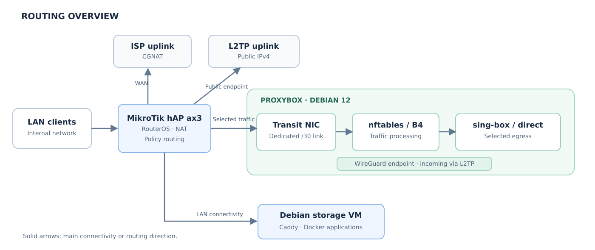

# Network routing, DNS and reverse proxy

MikroTik hAP ax3 is the LAN router and WAN edge. A separate Debian 12 Linux gateway (Proxybox) receives selected LAN traffic over a point-to-point transit link. The `storage` VM reaches the LAN through the KVM host's `br0` bridge.



## RouterOS policy routing

The edge router uses its normal CGNAT ISP uplink and a provider L2TP connection with public IPv4. The main routing table serves ordinary connectivity; policy routing steers eligible LAN traffic to Proxybox and keeps management and selected source addresses on their intended paths.

| Routing element | Purpose |
| --- | --- |
| `main` | Normal ISP route and connected networks |
| `to-l2tp` | Public-IPv4 L2TP egress for designated source traffic |
| `via-proxybox` | Default route via the dedicated transit link to Proxybox |
| `lookup main min-prefix=0` | Preserve access to more-specific main-table routes before selecting the proxy path |
| Source-specific rules | Keep management and gateway egress identities on the correct uplink |

The public-IPv4 path also forwards inbound WireGuard traffic to Proxybox and the configured Caddy entry point for externally published web services.

I originally tried running Zapret/nfqws in a RouterOS container, but the transparent interception setup did not meet my requirements. I moved that processing to Debian, where nftables and Linux routing policy are directly available.

## Debian gateway

Proxybox uses separate LAN identities for management and service egress, a dedicated transit NIC to the router, and `wg-home` for remote WireGuard access. Its networking stack includes:

- Linux `ip rule` with firewall marks and separate routing tables;
- nftables tables `proxybox_guard` and `proxybox_transit` for special-destination marking and transit SNAT;
- B4-managed `b4_mangle` (NFQUEUE) and `b4_route` (TPROXY) tables;
- sing-box for outbound proxy and tunnel connections.

The SNAT path translates eligible traffic from the router-facing transit interface into the gateway's selected LAN egress identity so RouterOS can apply source-based routing on the return to the router. See [Transparent packet processing](transparent-proxy-architecture.md) for the packet classification stages.

## Internal DNS and Caddy

DHCP clients use MikroTik (`192.168.10.1`) for DNS. RouterOS holds static A records for the internal `home.arpa` zone, with most application names resolving to the `storage` VM (`192.168.10.20`). The Caddy system service on that VM loads individual sites from `/etc/caddy/sites.d/*.caddy` and reverse-proxies requests to loopback-bound application ports.

| DNS hostname | Service | Caddy upstream |
| --- | --- | --- |
| `git.home.arpa` | Forgejo | `127.0.0.1:3000` |
| `photos.home.arpa` | Immich | `127.0.0.1:2283` |
| `files.home.arpa` | Copyparty | `127.0.0.1:3923` |
| `music.home.arpa` | Navidrome | `127.0.0.1:4533` |
| `archive.home.arpa`, `*.archive.home.arpa` | ArchiveBox | `127.0.0.1:8000` |
| `torrent.home.arpa` | qBittorrent | `127.0.0.1:8080` |
| `deemix.home.arpa` | deemix | `127.0.0.1:6595` |

These internal sites are configured as **HTTP** virtual hosts. DNS resolution occurs on MikroTik; after resolving the name, clients connect to Caddy on the VM.

## DNS and route fallback

A RouterOS Netwatch probe looks up `storage.home.arpa` through the DNS service on Proxybox (`192.168.10.99`) every 10 seconds, with a 2-second timeout. Its state changes trigger two actions together:

| DNS health check | RouterOS upstream DNS | `Proxybox primary` route in `via-proxybox` |
| --- | --- | --- |
| UP | `192.168.10.99` | Enabled |
| DOWN | `77.88.8.8`, `77.88.8.1` | Disabled |

Both scripts flush the DNS cache. The local `home.arpa` A records stay on MikroTik and do not depend on the current upstream. Netwatch has recorded transitions in both directions.

### Useful checks

```routeros
/tool netwatch print detail
/tool netwatch print stats
/ip dns print
/ip dns static print detail
/ip route print detail where comment="Proxybox primary"
```

Expected in the normal operating state: the DNS check is `up`, upstream DNS points to Proxybox, and the policy route is enabled and active. On `storage`, `sudo caddy validate --config /etc/caddy/Caddyfile` validates the imported site definitions; `curl -I http://git.home.arpa` tests the reverse-proxy path.
