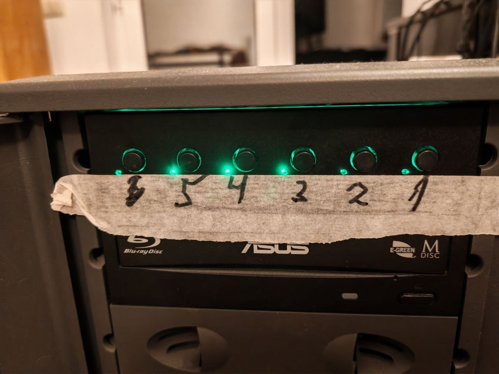
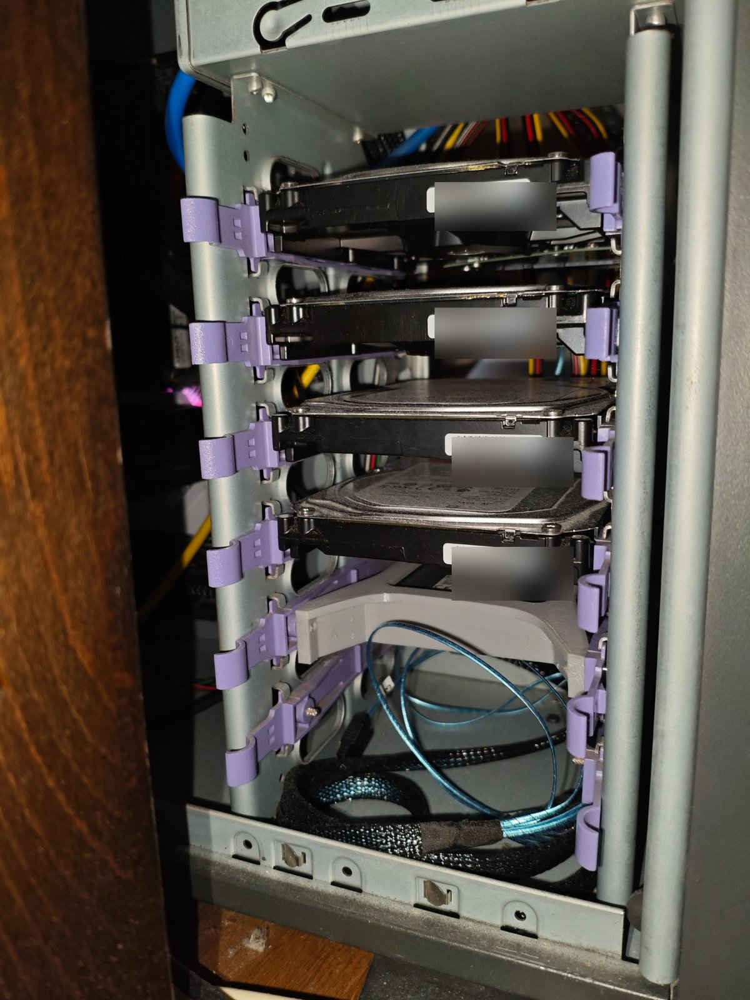

# Btrfs storage and backup layout

The Debian `storage` VM receives two physical SSDs and three 4 TB HDDs through an LSI SAS2308 HBA passed through from the KVM host. Each drive uses its **own Btrfs filesystem**; this is not a Btrfs RAID arrangement.

| Disk | Capacity | Mount | Role |
| --- | --- | --- | --- |
| SSD-A | 480 GB | `/srv/storage/ssd-a` | Forgejo backup snapshots |
| SSD-B | 480 GB | `/srv/storage/ssd-b` | Persistent application data |
| HDD-A | 4 TB | `/srv/storage/hdd-a` | Primary file collection and media |
| HDD-B | 4 TB | `/srv/storage/hdd-b` | Replicated `files` subvolume from HDD-A |
| HDD-C | 4 TB | `/srv/storage/hdd-c` | Additional storage |

There is also a Btrfs volume at `/srv/services` on the VM's virtual `vdb` disk for service configuration, and an independent 4 TB Btrfs disk mounted at `/srv/backup-a` on the physical Arch host for personal archives.

## Forgejo: scheduled SSD-to-SSD replication

Forgejo's persistent data is a Btrfs subvolume on SSD-B. A backup script stops the application briefly, creates a read-only snapshot, restarts Forgejo and transfers the snapshot to SSD-A with `btrfs send/receive`. Later runs use `btrfs send -p` and a common read-only parent to transfer incremental changes. A systemd oneshot service and daily timer run the workflow.

The received snapshot was used to start an isolated restored container. The restored application served HTTP and its SQLite integrity check returned `ok`. The timer has also completed an unattended run successfully.

[Backup and restore procedure](services/forgejo-backup-and-restore.md) · [Script and systemd units](../examples/backup/forgejo/README.md)

## File archive: HDD-A to HDD-B

A read-only snapshot of the Btrfs `files` subvolume on HDD-A was sent to HDD-B using `btrfs send/receive`. The transfer ran as a transient systemd service so the session could disconnect while it completed. The destination was checked as a read-only received snapshot; selected files were restored from it and compared against their sources with `cmp`.

This is a full **on-demand archive replication**, separate from the daily Forgejo backup automation.

## Physical layout

The chassis includes a manual disk-power panel and an internal drive cage.

| Drive-power panel | Internal drive cage |
| --- | --- |
|  |  |

### Useful checks

On the Debian VM, `findmnt -M /srv/storage/ssd-a` and `findmnt -M /srv/storage/ssd-b` show the source and target mounts; `btrfs subvolume list -r /srv/storage/ssd-a` lists read-only subvolumes. For the scheduled Forgejo workflow, check `systemctl list-timers --all forgejo-btrfs-backup.timer` and `journalctl -u forgejo-btrfs-backup.service`.
