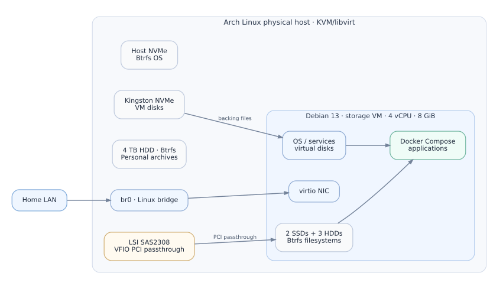

# KVM virtualization and PCI passthrough

An Arch Linux hypervisor runs the Debian `storage` VM. Application workloads live in the guest, while an LSI HBA is passed through so Linux inside the VM can manage the physical data disks directly.

## Host and guest

| Host | Configuration |
| --- | --- |
| CPU / motherboard | AMD Ryzen 7 5700G; ASUS PRIME X570-P |
| RAM | 64 GB DDR4-3200 |
| Operating system | Arch Linux |
| Virtualization | QEMU/KVM managed by libvirt (`qemu:///system`) |
| System disk | CUSU CV3500Q 512 GB NVMe, Btrfs |
| VM datastore | Kingston SNVS500G 500 GB NVMe, ext4 `/srv/vmstore` |
| Guest networking | Linux bridge `br0` |

| `storage` VM | Configuration |
| --- | --- |
| OS | Debian 13 (Trixie) |
| CPU and RAM | 4 vCPU; 8 GiB allocated |
| Boot | Libvirt autostart enabled |
| NIC | Virtio on `br0` |
| `vda` | 64 GiB QCOW2 guest OS disk (`storage-os.qcow2`) |
| `vdb` | 160 GiB QCOW2 Btrfs `/srv/services` (`storage-services.qcow2`) |

The virtual disk images reside in `/srv/vmstore/images/`.

## Direct-attached storage through VFIO

The **Broadcom/LSI SAS2308** HBA at PCI `0000:05:00.0` is bound to `vfio-pci` and assigned to the guest through libvirt. Inside Debian it exposes two SSDs and three HDDs as physical block devices, each with an independent Btrfs filesystem.

A useful distinction during diagnostics: `virsh domblklist storage` shows **the two QCOW2 drives (`vda`, `vdb`)**, not the disks behind the passed-through PCI controller. Check those inside the guest with `lsblk` and `findmnt`. Filesystem UUIDs are preferable to `/dev/sdX` names in persistent mount configuration.

## Operational checks

Run these on the **Arch host**:

| Purpose | Command | Expected result |
| --- | --- | --- |
| VM state | `virsh -c qemu:///system list --all` | Domain `storage` is listed |
| Autostart | `virsh -c qemu:///system dominfo storage` | `Autostart: enable` |
| Virtual disks | `virsh -c qemu:///system domblklist storage` | `vda`, `vdb` |
| Network attachment | `virsh -c qemu:///system domiflist storage` | NIC attached to `br0` |
| Controller ownership | `lspci -nnk -s 05:00.0` | `Kernel driver in use: vfio-pci` |

In the **Debian guest**, `lsblk -o NAME,SIZE,FSTYPE,MOUNTPOINTS` shows both virtual disks and HBA-attached drives. `findmnt -M /srv/storage/hdd-a` checks the primary data mount; `findmnt -M /srv/services` checks the services filesystem.
