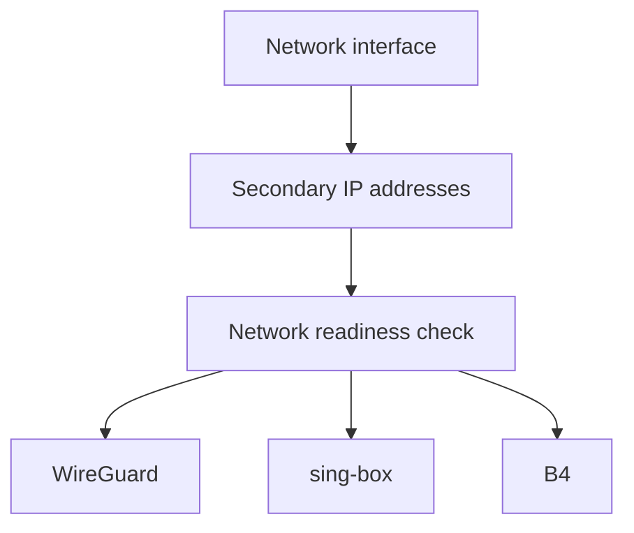

# Proxybox: systemd network-readiness gate

Proxybox uses additional LAN IPv4 addresses for distinct routing identities. These sample units show how the required addresses and default route are established before dependent services start.

| File | Role |
| --- | --- |
| `proxybox-secondary-ips.service` | One-shot, idempotent configuration of secondary IPv4 addresses |
| `proxybox-network-ready.service` | Checks for the expected addresses and default route, returning success when they exist |
| `proxybox-network-ready.service.d/override.conf` | Requires the address unit and orders it before readiness checks |

The unit examples replace local addresses with RFC 5737 documentation addresses (`192.0.2.0/24`). The original system uses its actual LAN addresses.

## Startup dependency graph



The readiness service polls for the expected interface addresses and default route. On the gateway, the effective dependencies of `wg-quick@wg-home.service`, `sing-box.service` and `b4.service` include **both `Requires=` and `After=`** for `proxybox-network-ready.service`. These relationships ensure that service startup depends on a successful readiness check, rather than ordering units with `Before=` alone.

## Diagnostic commands

```bash
systemctl show proxybox-secondary-ips.service proxybox-network-ready.service \
  wg-quick@wg-home.service sing-box.service b4.service \
  -p Id -p Requires -p After -p ActiveState -p SubState
ip -4 -br addr show dev enp1s0f0
ip -4 route show default
journalctl -b -u proxybox-secondary-ips.service \
  -u proxybox-network-ready.service --no-pager
```

Expected: all required LAN IPv4 addresses and a default route are present; service properties show that B4, sing-box and WireGuard require the readiness gate; the unit journal reports successful completion.
